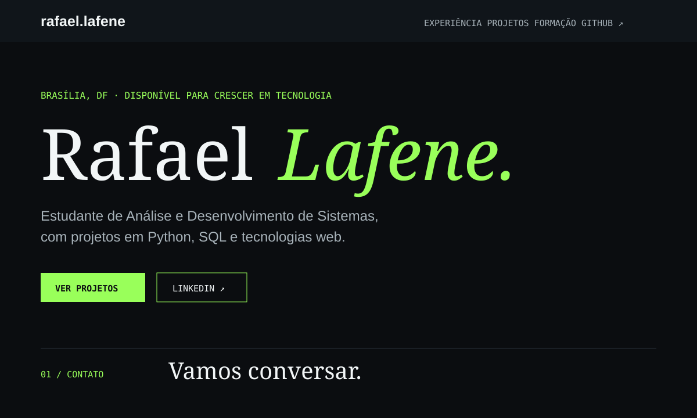

# Olá, eu sou Rafael Lafene 👋

Estudante de **Análise e Desenvolvimento de Sistemas** no UniCEUB, com formação em Ciências Contábeis. Estou construindo minha trajetória em tecnologia com foco em desenvolvimento web, dados e automação de processos.

- 💼 Atualmente, estagiário na **Engeconsult**, atuando com edição de documentos, automação de processos e análise de dados.
- 🐍 Desenvolvendo projetos com **Python**, **SQL**, **HTML**, **CSS** e **JavaScript**.
- 📍 Brasília, DF.

## Projetos em destaque

| Projeto | Tecnologias | Acesso |
| --- | --- | --- |
| Projetos em Python | Python | [Ver repositório](https://github.com/RafaelLafene/Projetos-python) |
| Banco de Dados | SQL, modelagem | [Ver repositório](https://github.com/RafaelLafene/Projetos-banco-de-dados-SQL) |
| Projetos Web | HTML, CSS | [Ver repositório](https://github.com/RafaelLafene/Projetos-site-) |

## Prévia do meu portfólio

O portfólio reúne minha formação, experiência e projetos em tecnologia.

## Vamos conectar?

[LinkedIn](https://www.linkedin.com/in/rafael-lafene-32087030a) · [GitHub](https://github.com/RafaelLafene)
